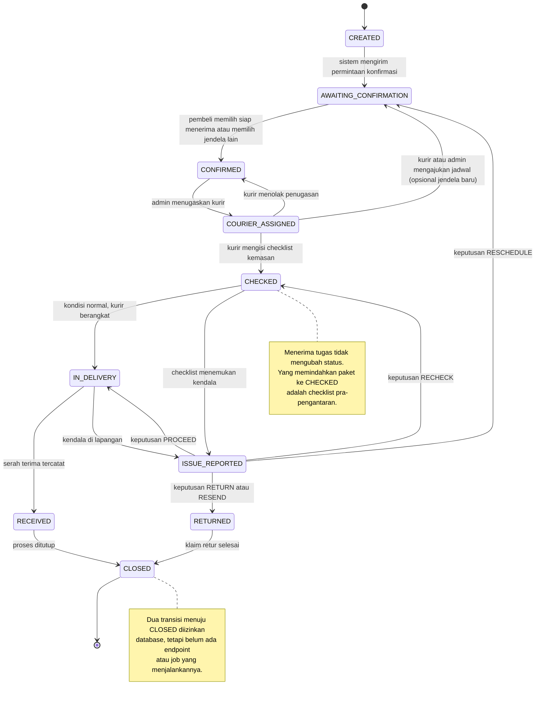
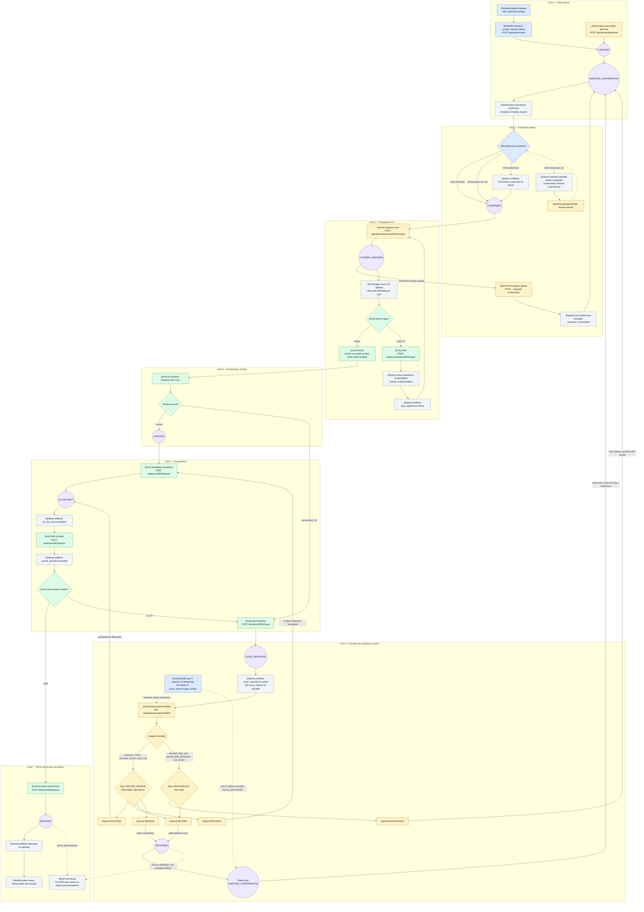
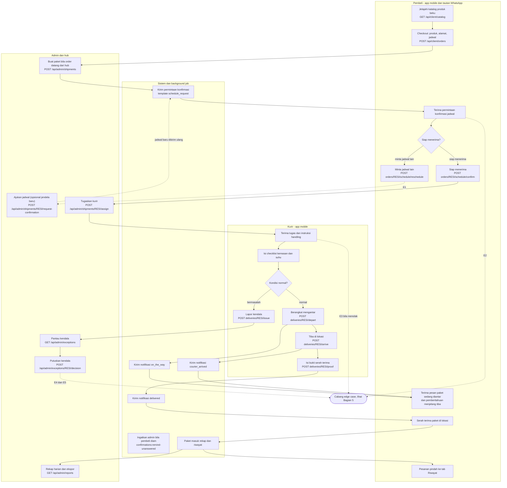
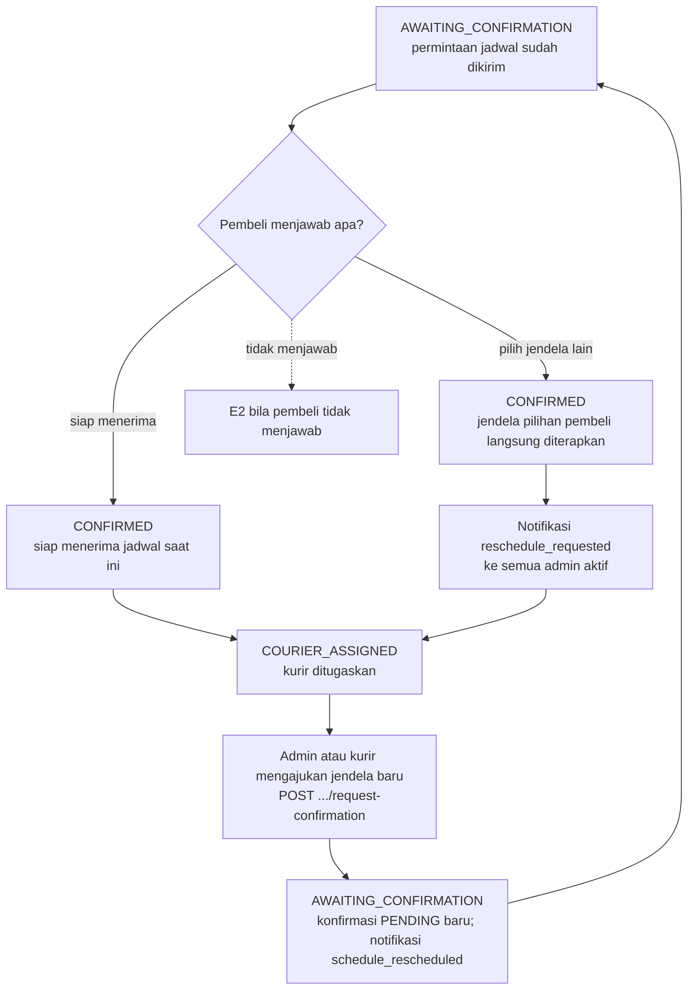
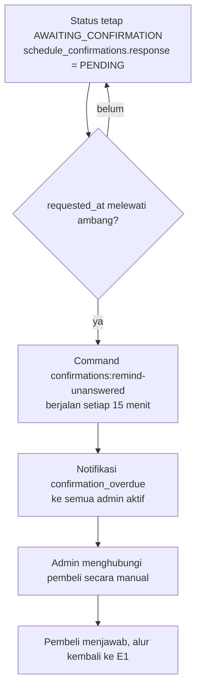
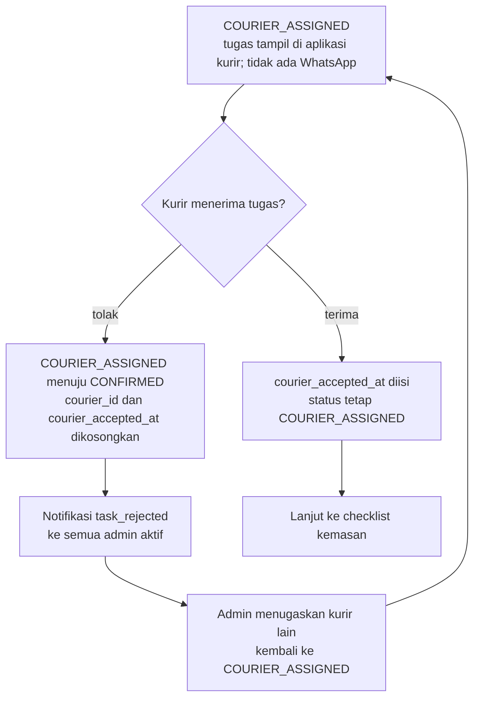
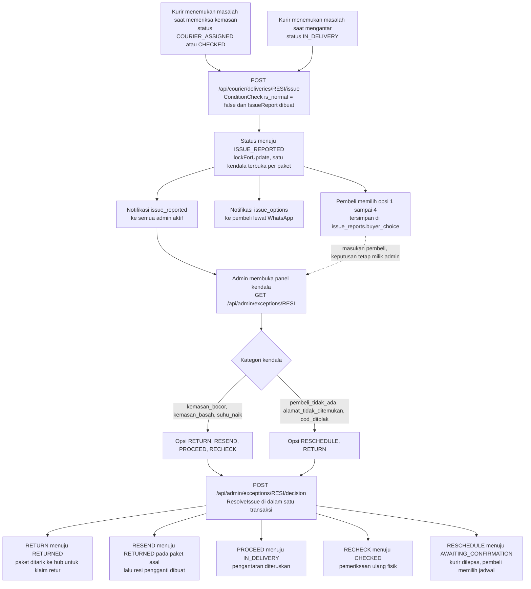
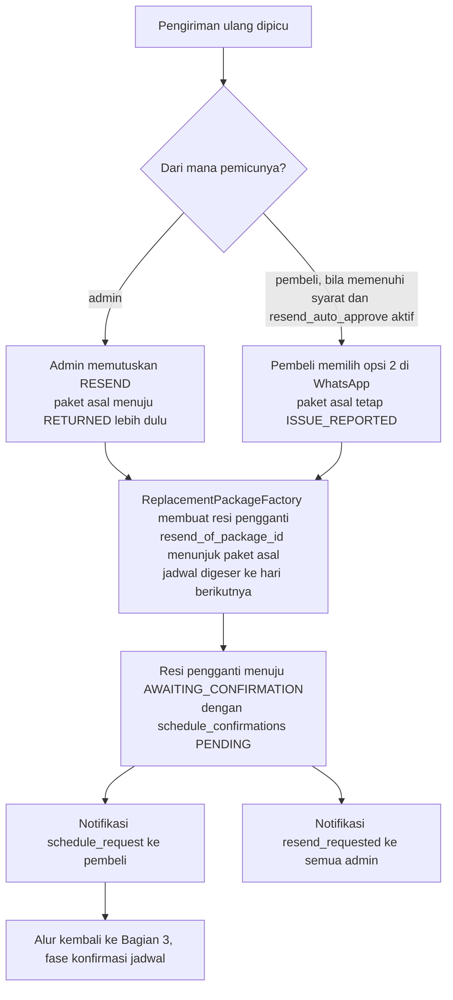
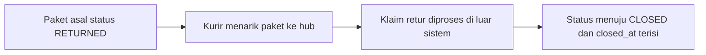
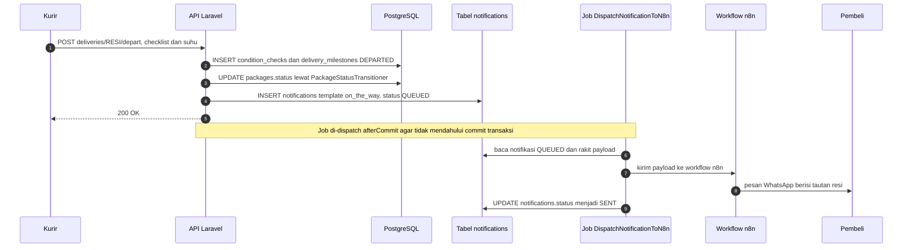

# Flow Map Anteraja Frozen: Good Case sampai Edge Case

Dokumen ini memetakan alur paket beku Anteraja sejak paket dibuat sampai proses ditutup, lengkap dengan cabang kasus di luar jalur normal. Semua diagram ditulis dengan Mermaid sehingga bisa dirender di GitHub, VS Code, dan Obsidian, dan pada saat yang sama tetap terbaca sebagai teks biasa oleh agent maupun developer.

Dua hal yang perlu dipegang saat membaca dokumen ini:

1. **Status dan panah di diagram bukan karangan.** Semuanya berasal dari tabel `package_statuses` dan `package_status_transitions` (lihat `database/seeders/ReferenceDataSeeder.php`) dan dijalankan lewat satu pintu `App\Support\PackageStatusTransitioner`. Kalau FSM di database berubah, dokumen ini yang harus disesuaikan lebih dulu.
2. **Yang digambar hanya alur yang sudah punya implementasi.** Improvisasi di luar jalur dasar, misalnya kurir mengobrol langsung dengan pembeli di luar alur notifikasi, belum masuk. Bagian 8 mencatat bagian yang belum terhubung.

Konvensi penulisan: nama status selalu memakai kode database dalam huruf kapital, placeholder nomor resi ditulis `{resi}` pada tabel dan `RESI` pada label diagram, garis penuh berarti jalur normal, garis putus-putus berarti cabang edge case. Bagian 3 merangkai semuanya menjadi satu diagram utuh, sementara Bagian 5 memecah setiap cabang supaya lebih enak dibaca satu per satu.

---

## 1. Daftar Status Paket

| Kode | Label | Menunggu aksi? | Terminal? | Arti |
|---|---|:---:|:---:|---|
| `CREATED` | Dibuat | tidak | tidak | Baris paket sudah ada, permintaan konfirmasi belum dikirim |
| `AWAITING_CONFIRMATION` | Menunggu Konfirmasi | ya | tidak | Permintaan jadwal sudah dikirim, menunggu jawaban pembeli |
| `CONFIRMED` | Dijadwalkan | tidak | tidak | Jadwal disetujui pembeli, siap ditugaskan ke kurir |
| `COURIER_ASSIGNED` | Kurir Ditugaskan | tidak | tidak | Kurir sudah dipilih, checklist kemasan belum diisi |
| `CHECKED` | Sudah Diperiksa | tidak | tidak | Checklist kemasan dan suhu sudah diisi |
| `ISSUE_REPORTED` | Kendala | ya | tidak | Ada laporan kendala yang menunggu keputusan admin |
| `IN_DELIVERY` | Sedang Diantar | tidak | tidak | Kurir sedang di jalan |
| `RECEIVED` | Diterima | tidak | tidak | Serah terima sudah tercatat |
| `RETURNED` | Dikembalikan | tidak | tidak | Paket ditarik ke hub untuk retur atau diganti resi baru |
| `CLOSED` | Selesai | tidak | ya | Proses ditutup dan masuk laporan |

Dua status penanda antrian kerja, `AWAITING_CONFIRMATION` dan `ISSUE_REPORTED`, dihitung dari kolom `is_waiting` sehingga panel admin bisa menampilkan pekerjaan yang menggantung tanpa logika tambahan.

## 2. Peta Transisi Status (FSM)



## 3. Alur Lengkap dalam Satu Diagram

Bagian ini adalah versi gabungan yang Anda minta. Semua jalur, baik good case maupun edge case, digambar dalam satu diagram karena cabang-cabangnya memang kembali bermuara ke jalur utama yang sama.

### 3.1 Satu Diagram untuk Semua Jalur

Mulai dari Fase 1 di bagian atas lalu turun sampai Fase 7. Garis penuh adalah jalur normal, garis putus-putus adalah lompatan yang hanya terjadi pada kondisi tertentu, dan setiap cabang yang memutar paket kembali ke fase sebelumnya digambar sebagai panah yang menunjuk balik ke node fase itu. Di situlah terlihat bahwa E1, E3, dan keputusan `RESCHEDULE` mengembalikan paket ke tahap yang sudah dilewati, bukan menciptakan alur baru.



Warnanya menandai peran: biru untuk pembeli, kuning untuk admin, hijau untuk kurir, abu-abu untuk sistem, dan ungu untuk status paket. Setiap kotak juga sudah diawali peran di dalam kurung siku, jadi diagramnya tetap terbaca kalau warnanya tidak muncul. Kotak berbentuk kapsul adalah status di kolom `packages.status`, sedangkan kotak persegi adalah tindakan.

### 3.2 Alur yang Sama, Dilihat Per Peran

Kalau yang dibutuhkan hanya pembagian tanggung jawab tanpa percabangan, versi per peran di bawah ini lebih enak dibaca. Isinya sama dengan diagram di atas, hanya tanpa garis putus-putus edge case.



Ada dua pintu masuk yang sama-sama sah untuk langkah pertama. Pembeli bisa memulai sendiri dari katalog aplikasi (`POST /api/client/orders`), atau admin memasukkan paket dari hub (`POST /api/admin/shipments`). Keduanya berakhir di titik yang sama: baris `packages` berstatus `CREATED` yang langsung dipindahkan ke `AWAITING_CONFIRMATION` supaya `status_logs` tetap lengkap.

## 4. Rincian Tiap Fase

| Fase | Aktor | Aksi | Endpoint | Status sesudah | Notifikasi |
|---|---|---|---|---|---|
| 1. Paket dibuat | Pembeli atau Admin | Checkout dari katalog, atau input manual di hub | `POST /api/client/orders`, `POST /api/admin/shipments` | `CREATED` | tidak ada |
| 2. Penugasan kurir | Admin | Pilih kurir aktif | `POST /api/admin/shipments/{resi}/assign` | `COURIER_ASSIGNED` | tidak ada (kurir melihat tugas di aplikasi) |
| 3. Permintaan konfirmasi jadwal | Kurir atau Admin | Minta penerima mengonfirmasi tanggal terima, opsional dengan jendela baru | `POST /api/courier/deliveries/{resi}/request-confirmation`, `POST /api/admin/shipments/{resi}/request-confirmation` | `AWAITING_CONFIRMATION` | `schedule_request` (atau `schedule_rescheduled` bila jendela diubah) ke penerima |
| 4. Konfirmasi jadwal | Penerima | Pilih siap menerima, atau memilih jendela lain (langsung diterapkan) | `POST .../schedule/confirm`, `POST .../schedule/reschedule` | `CONFIRMED` | `reschedule_requested` ke admin bila pembeli memilih jendela lain |
| 5. Pemeriksaan dan keberangkatan | Kurir | Isi checklist kemasan dan suhu | `POST /api/courier/deliveries/{resi}/depart` | `CHECKED` lalu `IN_DELIVERY` | `on_the_way` dan `delivery_pin` ke penerima |
| 6. Pengantaran | Kurir | Tandai tiba di lokasi | `POST /api/courier/deliveries/{resi}/arrive` | tetap `IN_DELIVERY` | `courier_arrived` ke penerima |
| 7. Serah terima | Kurir | Catat nama penerima, relasi, foto, catatan, dan PIN penerima | `POST /api/courier/deliveries/{resi}/proof` | `RECEIVED` | `delivered` ke penerima |
| 8. Penutupan | Sistem | Paket masuk rekap harian dan riwayat | `GET /api/admin/reports` | secara desain `CLOSED`, praktiknya berhenti di `RECEIVED` | tidak ada |

Fase 4 menarik untuk dicatat: satu request kurir melakukan dua transisi berurutan, `COURIER_ASSIGNED` menuju `CHECKED` menuju `IN_DELIVERY`. Kalau status sudah `CHECKED` karena keputusan `RECHECK` admin, transisi pertama dilewati dan yang dijalankan hanya `CHECKED` menuju `IN_DELIVERY`.

## 5. Cabang Edge Case

Bagian ini adalah pembesaran dari cabang di Bagian 3. Tujuannya supaya tiap kondisi bisa dibaca tenang satu per satu, lengkap dengan efek tiap keputusan terhadap status paket.

### 5.1 E1 - Pembeli meminta jadwal lain, bisa berulang



Pembeli yang memilih jendela lain tidak menunggu admin: jendelanya langsung diterapkan dan paket menjadi `CONFIRMED`, sementara admin tetap menerima notifikasi. Admin atau kurir dapat mengajukan jendela baru setelah paket ditugaskan (`COURIER_ASSIGNED`) lewat aksi yang sama dengan permintaan konfirmasi; paket kembali ke `AWAITING_CONFIRMATION` dan penerima mengonfirmasi sekali lagi. Permintaan pembeli bersifat idempoten: menekan tombol dua kali saat paket sudah `CONFIRMED` tidak membuat transisi kedua.

### 5.2 E2 - Pembeli tidak merespons



Tidak ada transisi status di jalur ini. Paket sengaja dibiarkan di `AWAITING_CONFIRMATION` karena keputusan tetap menunggu manusia. Ambang waktunya diambil dari `coldchain.client.unanswered_after_minutes` dengan nilai bawaan 120 menit, dan reminder di-dedup per `confirmation_id` supaya admin tidak dibanjiri pesan berulang untuk paket yang sama.

### 5.3 E3 - Kurir menolak penugasan



Kurir hanya bisa menolak selama `courier_accepted_at` masih kosong. Setelah menerima tugas, tombol tolak tertutup dan satu-satunya jalan keluar dari penugasan adalah jalur kendala.

### 5.4 E4 dan E5 - Kendala, lalu keputusan admin

E4 adalah kendala yang ketahuan saat pemeriksaan kemasan, E5 adalah kendala yang ketahuan di jalan. Keduanya bermuara ke pintu masuk yang sama.



Keputusan yang diizinkan dibatasi kategori kendala. Ini penting karena paket yang tidak bisa diperiksa ulang, misalnya pembeli tidak di tempat, tidak boleh menawarkan opsi `RECHECK`.

| Kategori kendala | Keputusan yang diizinkan |
|---|---|
| `kemasan_bocor`, `kemasan_basah`, `suhu_naik` | `RETURN`, `RESEND`, `PROCEED`, `RECHECK` |
| `pembeli_tidak_ada`, `alamat_tidak_ditemukan`, `cod_ditolak` | `RESCHEDULE`, `RETURN` |

Efek tiap keputusan, semuanya dijalankan di dalam transaksi yang sama dengan penguncian baris paket dan laporan kendala:

| Keputusan | Status paket | Efek | Notifikasi |
|---|---|---|---|
| `RETURN` | `RETURNED` | Paket ditarik ke pusat distribusi untuk klaim retur | `issue_decision_update` ke pembeli |
| `RESEND` | `RETURNED` pada paket asal, resi pengganti di `AWAITING_CONFIRMATION` | Resi baru dibuat dan ditautkan lewat `resend_of_package_id` | `issue_decision_update` ke pembeli, `schedule_request` dan `resend_requested` untuk resi baru |
| `PROCEED` | `IN_DELIVERY` | Pengantaran diteruskan, kompensasi parsial bila disetujui pembeli | `issue_decision_update` ke pembeli |
| `RECHECK` | `CHECKED` | Pemeriksaan ulang kondisi fisik di lapangan | `issue_decision_update` ke pembeli |
| `RESCHEDULE` | `AWAITING_CONFIRMATION` | Kurir dilepas, pembeli memilih jadwal baru | `schedule_request` ke pembeli |

Pilihan pembeli lewat WhatsApp, opsi 1 sampai 4, hanya tersimpan sebagai `buyer_choice` dan diteruskan ke admin sebagai masukan. Keputusan resmi tetap ada di tangan admin, sehingga tidak ada jalur di mana pembeli mengubah status paket sendirian.

### 5.5 E6 - Resi pengganti



Ada dua pemicu pengiriman ulang dan keduanya berujung pada resi baru yang kembali ke fase konfirmasi jadwal. Bedanya, jalur admin menutup paket asal ke `RETURNED` lebih dulu, sedangkan jalur pembeli lewat `POST .../issue/resend` atau opsi 2 di WhatsApp meninggalkan paket asal di `ISSUE_REPORTED` karena keputusan kendalanya belum diambil admin. Kelayakan pengiriman ulang disaring oleh `App\Services\Client\ReplacementEligibility`, dan pembuatan resi baru dilindungi indeks unik parsial `uq_packages_one_replacement` supaya satu paket asal tidak pernah punya dua resi pengganti.

### 5.6 E7 - Retur dan penutupan



Transisi `RETURNED` menuju `CLOSED` dan `RECEIVED` menuju `CLOSED` sudah diizinkan database, tetapi belum ada endpoint, action, atau job yang menjalankannya. Selama itu belum ada, rekap harian tetap membaca paket selesai dari tabel `deliveries` dan laporan kendala dari `issue_reports`, bukan dari status `CLOSED`. Lihat Bagian 8.

## 6. Rantai Notifikasi dan Background Job



Semua pesan ke pembeli, kurir, dan admin melewati satu antrean yang sama: baris di tabel `notifications`, lalu job `DispatchNotificationToN8n`, lalu workflow n8n yang mengirim WhatsApp. Karena payload notifikasi sudah memuat nomor penerima, nama, resi, dan tautan klien, workflow n8n tidak perlu membuka database aplikasi. Template yang belum dipetakan ke pesan WhatsApp dibiarkan berstatus `QUEUED`, bukan `FAILED`, supaya pemetaan bisa ditambah tanpa alarm palsu.

## 7. Matriks Ringkas Cabang Edge Case

| ID | Pemicu | Status sebelum menuju sesudah | Penanganan | Endpoint atau job |
|---|---|---|---|---|
| E1 | Pembeli memilih jendela lain, lalu admin/kurir mengajukan jendela baru | `AWAITING_CONFIRMATION` menuju `CONFIRMED` (pembeli), atau `COURIER_ASSIGNED` menuju `AWAITING_CONFIRMATION` (admin/kurir) | Jendela pembeli langsung diterapkan; jendela yang diajukan admin/kurir menunggu konfirmasi penerima | `POST /api/client/orders/{resi}/schedule/reschedule`, `POST /api/admin/shipments/{resi}/request-confirmation` |
| E2 | Pembeli tidak merespons melewati ambang waktu | tetap `AWAITING_CONFIRMATION` | Reminder otomatis ke admin | `confirmations:remind-unanswered` setiap 15 menit |
| E3 | Kurir menolak penugasan | `COURIER_ASSIGNED` menuju `CONFIRMED` | Penugasan dibatalkan, admin memilih kurir lain | `POST /api/courier/tasks/{resi}/reject` |
| E4 | Checklist kemasan menemukan masalah sebelum berangkat | `COURIER_ASSIGNED` atau `CHECKED` menuju `ISSUE_REPORTED` | Admin memutuskan lewat panel kendala | `POST /api/courier/deliveries/{resi}/issue`, `POST /api/admin/exceptions/{resi}/decision` |
| E5 | Kendala terjadi saat pengantaran | `IN_DELIVERY` menuju `ISSUE_REPORTED` | Sama seperti E4 | Sama seperti E4 |
| E6 | Pengiriman ulang disetujui | Paket asal `RETURNED`, resi pengganti `AWAITING_CONFIRMATION` | Resi baru dibuat otomatis, kembali ke fase konfirmasi | `POST /api/admin/exceptions/{resi}/decision`, `POST /api/client/orders/{resi}/issue/resend` |
| E7 | Paket retur ditarik ke hub | `RETURNED` menuju `CLOSED` | Belum terhubung ke endpoint mana pun | belum ada |

## 8. Celah yang Belum Terhubung

Bagian ini penting supaya dokumen tidak menjanjikan lebih dari yang sudah jalan.

- **Penutupan paket belum punya aktor.** Transisi ke `CLOSED` ada di matriks FSM dan kolom `closed_at` sudah tersedia, tetapi tidak ada endpoint, action, atau job yang menjalankannya. Selama ini belum ditutup, paket berhenti di `RECEIVED` atau `RETURNED` dan rekap harian tetap menghitungnya sebagai selesai.
- **Pengiriman ulang dari sisi pembeli tidak mengubah status paket asal.** Pada jalur ini paket asal tetap `ISSUE_REPORTED` sampai admin mengambil keputusan, sehingga paket bisa muncul di daftar kendala sekaligus sudah punya resi pengganti.
- **Kurir mengobrol langsung dengan pembeli** di luar alur notifikasi belum digambar karena belum ada di backend. Kalau nanti diimplementasikan, tempatnya adalah cabang E4 dan E5.

## 9. Catatan Pemeliharaan

Kalau ada perubahan alur, urutan yang benar adalah mengubah matriks di `database/seeders/ReferenceDataSeeder.php` lebih dulu, menambah migrasi bila perlu, baru memperbarui dokumen ini. Diagram di sini adalah cermin dari FSM di database, dan cara termurah untuk memeriksanya adalah membandingkan daftar transisi di Bagian 2 dengan isi tabel `package_status_transitions`.

Berkas ini sengaja diletakkan di `docs/` bersama `client-api.md` dan `client-data-contract.md` supaya tidak menyerempet area frontend, dan sengaja memakai Mermaid supaya bisa dirender oleh manusia sekaligus dibaca sebagai teks oleh agent yang bekerja di repositori ini.

Versi D2 dari diagram gabungan dan peta FSM tersedia di `docs/diagrams/`, lengkap dengan skrip render dan pembukanya. Dari akar repositori:

```bash
bash docs/diagrams/render.sh                 # hasilkan SVG, PNG, dan teks ASCII
bash docs/diagrams/lihat.sh                  # buka diagram gabungan dari terminal
bash docs/diagrams/lihat.sh -t fsm-status    # baca versi teks di terminal
```
